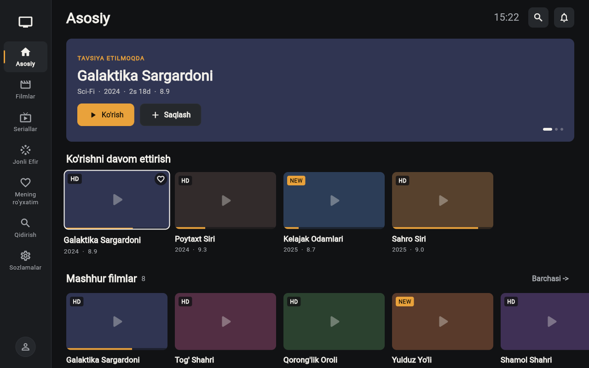
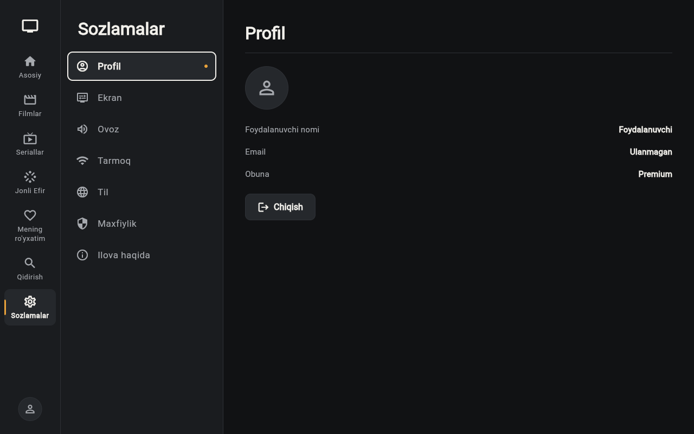

# 📺 Smart TV Streaming Platform (`smart_tv_app`)

[](https://github.com/okiljon04344/smart_tv_app/actions/workflows/ci.yml)
[](https://flutter.dev)
[](https://dart.dev)
[](https://firebase.google.com)
[](#)

> **🇯🇵 日本語** | **🇬🇧 English** | **🇺🇿 O'zbekcha**

---

## 📸 Screenshots / スクリーンショット

| Home & Hero Banner | Content Details | Settings & Localization |
| :---: | :---: | :---: |
|  |  |  |

---

## 🇯🇵 日本語 (Japanese Overview)

### プロジェクト概要
**Smart TV App** は、Android TV・Google TV・デスクトップ・Web 向けに設計された、10フィートUI（テレビリモコン / D-Pad ナビゲーション完全対応）の動画ストリーミングプラットフォームです。

### 主な機能・技術的ハイライト
- **🎮 フル D-Pad / TVリモコン対応 (`tv_key_helper.dart`)**:
  - Android TV リモコンの方向キー（上下左右）、決定キー（`Select` / `Enter` / `GameButtonA`）、戻るキー（`Back` / `Escape`）、メディア 재생/一時停止キーに完全対応。
  - KeyDown / KeyUp の重複発火防止ロジックと視覚的フォーカスインジケーターを全画面に実装。
- **🎬 ハイブリッド動画プレーヤー (`PlayerScreen`)**:
  - ローカル/MP4 ストリーム（`video_player`）および YouTube ストリーム（`youtube_player_flutter`）の自動判別再生、10秒スキップ、視聴進捗（Continue Watching）のリアルタイム保存。
- **☁️ オフラインファースト + Firebase 連携**:
  - Cloud Firestore によるリアルタイムカタログ同期と、ネットワーク切断時のローカルカタログ自動フォールバック。
  - Firebase Authentication（Google / メールログイン）＋ リモコン1クリックで利用できる **TV Demo / ゲストモード**。
- **🌐 多言語対応 (i18n)**:
  - ウズベク語 (`UZ`)・ロシア語 (`RU`)・英語 (`EN`) のリアルタイム切り替え。

---

## 🇬🇧 English Overview

### Project Summary
**Smart TV App** is a cross-platform 10-foot UI streaming application built with Flutter for **Android TV, Web, and Desktop**. It features full directional pad (D-Pad) remote control navigation, hybrid video playback, watch-progress synchronization, and an admin content management panel.

### Key Features
- **🎮 Dedicated TV Remote / D-Pad Engine (`lib/utils/tv_key_helper.dart`)**:
  - Unified key handling across Android TV hardware remotes (`LogicalKeyboardKey.select`, `goBack`, `mediaPlayPause`) and desktop keyboards (`enter`, `space`, `escape`, arrow keys) without duplicate event firing.
  - Explicit `FocusScope` management between the navigation sidebar, hero banner, horizontal content carousels, search tags, and settings panels.
- **📺 Continue Watching & Favorites (`FavoritesProvider`)**:
  - Tracks playback progress per title and persists watch history and favorite lists locally via `SharedPreferences`.
- **🔐 Auth & Instant TV Demo Mode (`AuthProvider`)**:
  - Supports Firebase Email/Password & Google Sign-In, plus a one-click **TV Demo / Guest Mode** for instant evaluation on Android TV emulators without typing credentials.
- **🛠️ Admin Dashboard (`AdminScreen`)**:
  - Built-in CRUD interface for managing streaming catalog items synced with Cloud Firestore.

---

## 🇺🇿 O'zbekcha ( Loyiha haqida )

**Smart TV App** — Android TV, Web va Desktop uchun Flutter'da yaratilgan zamonaviy media-striming ilovasi.
- **TV Pult (D-Pad) boshqaruvi**: Barcha ekranlar (`Login`, `Home`, `Search`, `Details`, `Player`, `Settings`) televizor pulti orqali to'liq boshqariladi.
- **TV Demo / Mehmon rejimi**: Login ekranida pult orqali bir tugmani bosib ro'yxatdan o'tmasdan ilovani sinab ko'rish imkoniyati mavjud.
- **Gibrid Video Pleyer**: MP4 va YouTube videolarni o'ynatish, 10 soniyaga oldinga/orqaga o'tkazish va ko'rilgan joyidan davom ettirish (`Continue Watching`).

---

## 🚀 Getting Started / 実行方法

```bash
# Install dependencies
flutter pub get

# Run static analysis & widget tests
flutter analyze
flutter test

# Run on Chrome / Desktop / Android TV
flutter run -d chrome
```

---

## 👤 Author / 開発者
**Oqiljon Nabiyev (ナビエフ・オキルジョン)**
- 🌐 Portfolio: [https://okiljon04344.github.io](https://okiljon04344.github.io)
- 🐙 GitHub: [@okiljon04344](https://github.com/okiljon04344)
