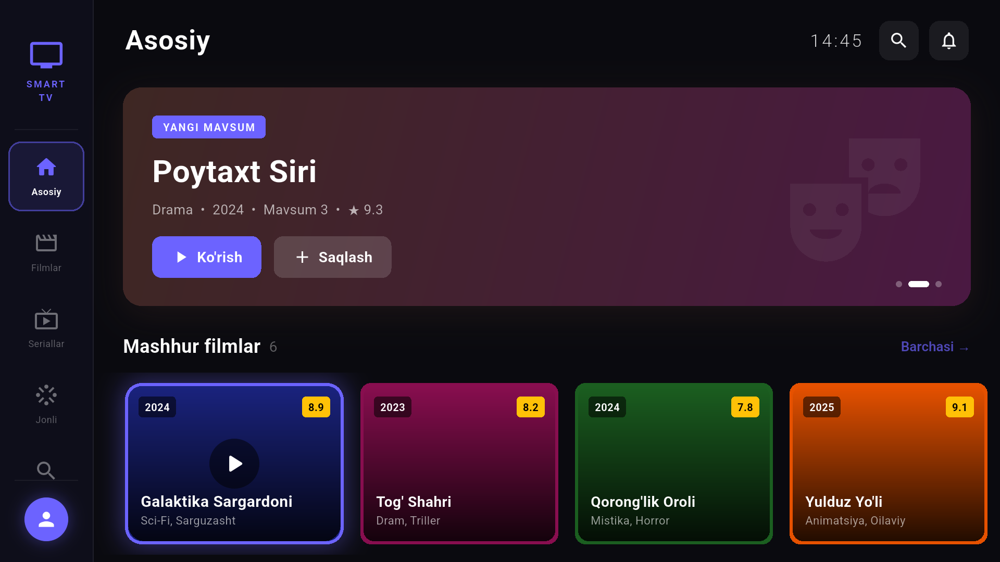
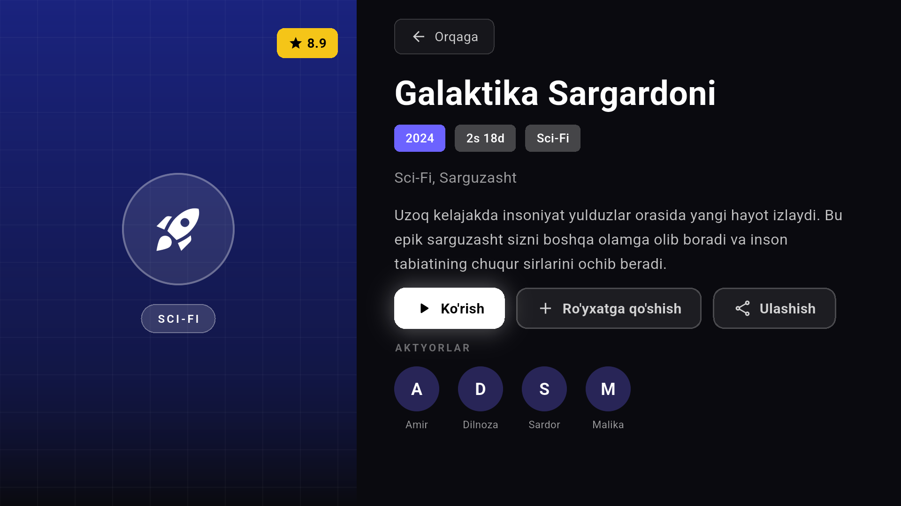
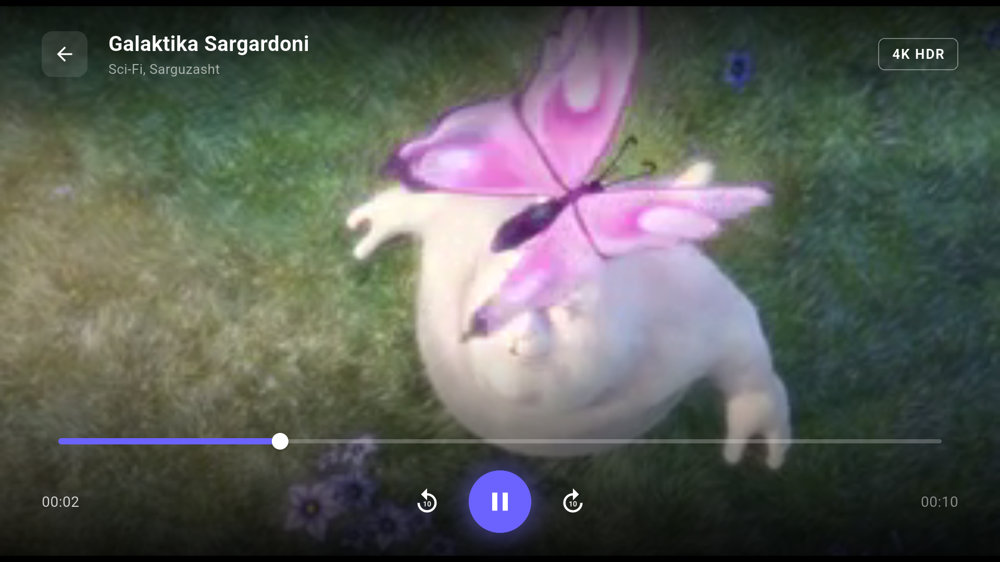

# Smart TV App

[](https://github.com/okiljon04344/smart_tv_app/actions/workflows/ci.yml)

日本語 | [English](#english) | [O'zbekcha](#ozbekcha)

## スクリーンショット

| ホーム | 作品詳細 | プレーヤー |
| :---: | :---: | :---: |
|  |  |  |

## 日本語

### 概要

Flutter と Firebase で作成した、テレビ向け（10フィートUI）の動画ストリーミングアプリです。Android TV のリモコン（D-Pad）操作を主な入力として想定し、Web・デスクトップでも動作します。個人で開発している学習・ポートフォリオ用のプロジェクトです。

### 実装している機能

- **D-Pad / リモコン操作**: 決定キー（`select` / `enter` / `gameButtonA` など）と戻るキー（`goBack` / `escape` / `browserBack`）を `lib/utils/tv_key_helper.dart` で処理します。KeyDown と KeyUp の両方が届く場合の二重発火を防ぎ、KeyUp のみ届くリモコンにも対応しています。画面ごとに `FocusScope` でフォーカス移動を管理しています。
- **動画プレーヤー**: YouTube の URL を持つ作品は `youtube_player_flutter`、それ以外はアプリ同梱のサンプル動画を `video_player` で再生します。10秒スキップと再生位置の保存に対応しています。
- **カタログ**: Firebase Realtime Database の `movies` / `categories` を購読して表示します。取得できない場合は、アプリ内のサンプルデータにフォールバックします。
- **認証**: メールアドレス / パスワード、Google サインイン、ゲストモード（TV Demo）。
- **お気に入りと視聴進捗**: `SharedPreferences` に保存します。お気に入りはログイン時に Realtime Database（`users/{uid}/favorites`）とも同期します。
- **多言語 UI**: ウズベク語・ロシア語・英語（`assets/lang/*.json`）。
- **管理画面**: 管理者アカウントでログインすると、Web またはスマートフォンサイズの画面で作品の登録・更新・削除ができます（`lib/screens/admin_screen.dart`）。デスクトップ・TV・タブレットサイズでは表示しません。

### 管理者設定

管理者のメールアドレスはソースコードに含めていません。

1. Firebase コンソールの Realtime Database で、管理者の UID を `/admins/{uid}` に `true` として登録します。`movies` / `categories` の書き込みと、他ユーザーのデータの参照は、このノードの有無で `database.rules.json` が判定します。
2. アプリの管理画面を表示するには、ビルド時に `--dart-define=ADMIN_EMAIL=...` を指定します。未指定の場合、管理画面は表示されません。

```bash
flutter run -d chrome --dart-define=ADMIN_EMAIL=admin@example.com
```

### セットアップ

```bash
flutter pub get
flutter analyze
flutter test
flutter run -d chrome
```

`lib/firebase_options.dart` は自分の Firebase プロジェクトに合わせて再生成してください（`flutterfire configure`）。`tools/` には Realtime Database の動画データを Firebase CLI で編集する PowerShell スクリプト（`admin-video.ps1`）、`seed/` には初期データの JSON があります。

### テスト

- `test/tv_key_helper_test.dart`: キー判定と二重発火防止
- `test/catalog_parsing_test.dart`: Realtime Database 形式のデータ変換と `seed/*.json` の読み込み
- `test/widget_test.dart`: ログイン画面からゲストモードでホーム画面へ遷移する流れ

GitHub Actions で `flutter analyze` と `flutter test` を実行しています。

## English

A 10-foot UI video streaming app built with Flutter and Firebase. It is designed around Android TV remote (D-pad) input and also runs on web and desktop. It is a personal learning and portfolio project.

- D-pad / remote handling with a duplicate-fire guard for KeyDown and KeyUp (`lib/utils/tv_key_helper.dart`).
- Player for YouTube links (`youtube_player_flutter`) and bundled sample videos (`video_player`), with 10-second seek and saved watch progress.
- Catalog read from Firebase Realtime Database, with a local sample-data fallback.
- Email/password, Google sign-in and a guest mode.
- UI languages: Uzbek, Russian, English.

**Admin setup.** No admin e-mail is stored in the source. Register admin accounts under `/admins/{uid}` in Realtime Database (Firebase console); `database.rules.json` uses that node for write access to `movies` and `categories`. To show the admin panel in the app, build with `--dart-define=ADMIN_EMAIL=you@example.com`. Without it, the panel is hidden.

```bash
flutter pub get && flutter analyze && flutter test
```

## O'zbekcha

Flutter va Firebase yordamida yaratilgan televizor uchun video-striming ilovasi. Android TV pulti (D-Pad) bilan boshqarishga mo'ljallangan, Web va Desktop'da ham ishlaydi. Bu shaxsiy o'quv va portfolio loyihasi.

- Pult (D-Pad) boshqaruvi: `lib/utils/tv_key_helper.dart`.
- Pleyer: YouTube havolalari va ilova bilan birga keladigan namunaviy videolar, 10 soniyaga o'tkazish, ko'rilgan joyni saqlash.
- Katalog Firebase Realtime Database'dan olinadi, ulanish bo'lmasa mahalliy namunaviy ma'lumotlar ishlatiladi.
- Email/parol, Google orqali kirish va mehmon rejimi.
- Tillar: o'zbek, rus, ingliz.

Admin hisoblari Firebase konsolida `/admins/{uid}` ostida ro'yxatdan o'tkaziladi. Admin panelni ko'rsatish uchun ilovani `--dart-define=ADMIN_EMAIL=...` bilan ishga tushiring.

## 開発者 / Author

Okiljon Nabiev (ナビエフ・オキルジョン)

- Portfolio: [okiljon04344.github.io](https://okiljon04344.github.io)
- GitHub: [@okiljon04344](https://github.com/okiljon04344)
